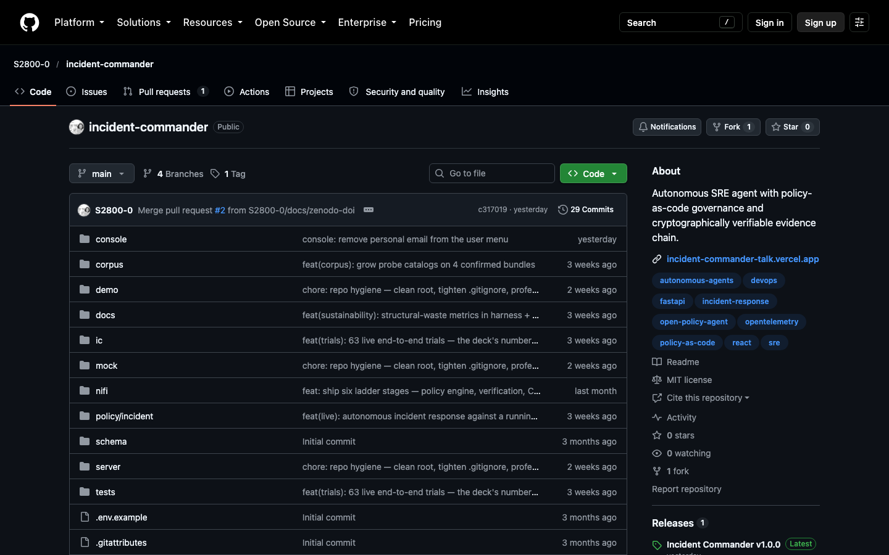
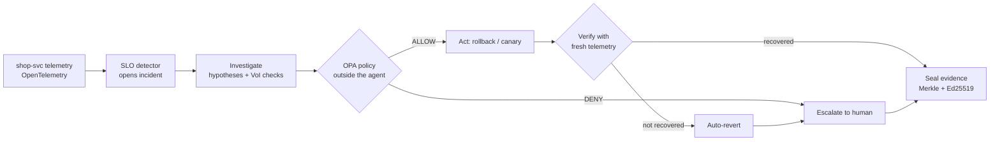
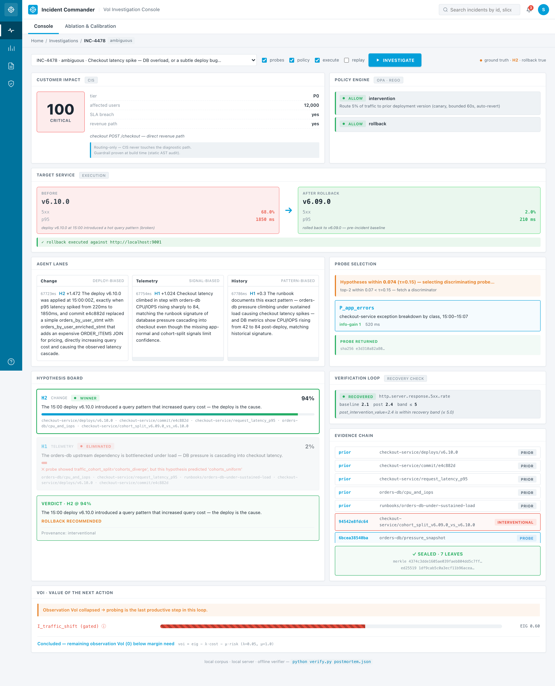
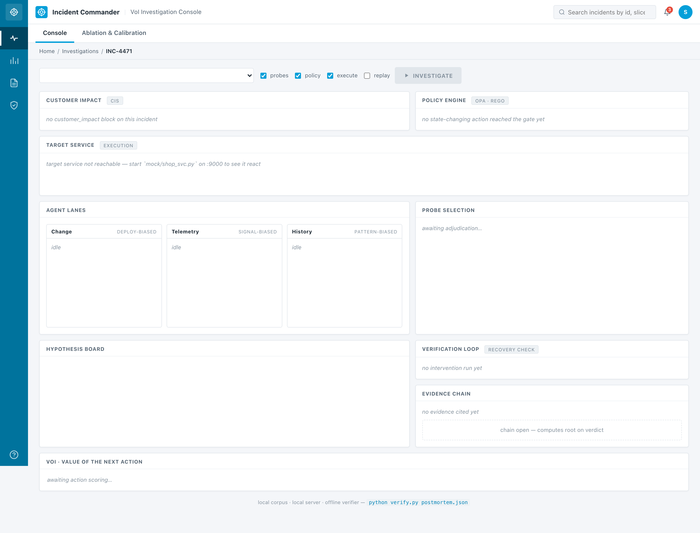
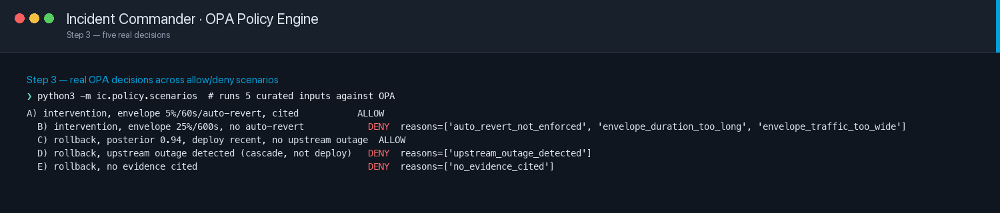
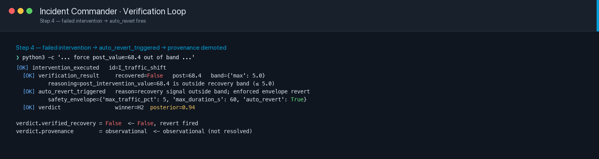
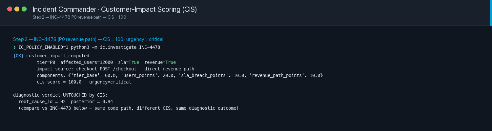
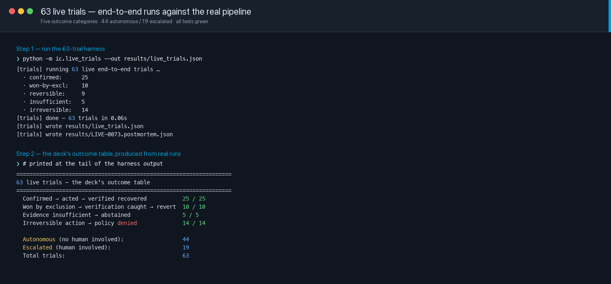
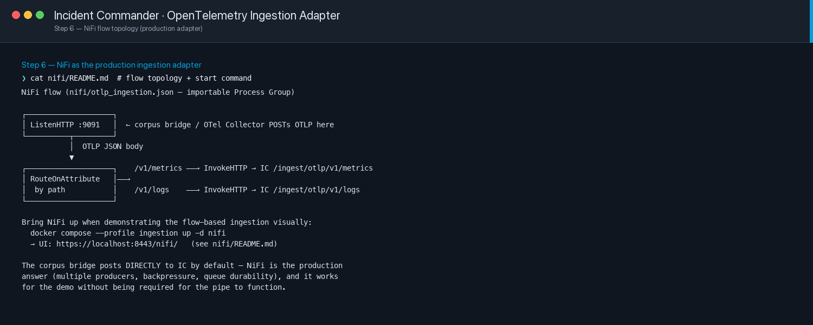

# 2. Phase 1: the demo system

This is the public project ([github.com/incident-commander-lab/incident-commander](https://github.com/incident-commander-lab/incident-commander), DOI 10.5281/zenodo.23276216). It is a working agent on a small mock shop, built to show **the loop**, not to measure it. Chapters 4–6 do the measuring.

## The loop

1. **Investigate.** Competing hypotheses get probabilities, and the next check is the one worth the most information per cost.
2. **Ask.** OPA, a separate program, says ALLOW or DENY. The agent cannot skip it.
3. **Act** only if allowed, and only reversible actions.
4. **Verify** with telemetry collected *after* the action.
5. **Auto-revert** if the fix didn't hold.
6. **Seal.** Every step is a leaf in a signed Merkle tree; `python verify.py` checks it offline.

## The console

One incident (INC-4478): a checkout latency spike that could be the database or a bad deploy. You can see the customer-impact score (top left), the OPA verdicts (top right), before and after rollback, the hypothesis board (H2 wins at 94%, H1 eliminated), and the sealed evidence chain.

When the fix doesn't hold, the agent undoes its own change:

## Safety: OPA decides, not the agent

Five real policy decisions. Small, time-boxed, auto-reverting interventions are allowed. Too wide, too long, no evidence cited, or the outage is upstream: denied.

## Verification and auto-revert

A forced bad result: recovery is outside the allowed band, so the revert fires and the verdict is downgraded to "observational".

## Customer impact score (CIS)

The impact score only *routes* urgency. It never changes the diagnosis.

## The 63-trial harness

All five outcome types, end-to-end through the same code: confirmed and fixed, caught by verification, abstained, policy denied.

## Data pipeline (NiFi)

OpenTelemetry samples flowing through NiFi into normalized evidence:

## What Phase 1 does *not* prove

The demo uses hand-written scenarios and a mock shop. It shows the loop works, not that the rule is better than an LLM. That is why RQ1 uses an outside benchmark, RQ2 a simulator with baselines, and RQ3 a live system.

> Note: two older screenshots in `demo/screenshots/opa/` (steps 5 and 6) captured a Python `SyntaxError` instead of the real output. They should be re-captured before anyone uses them.
