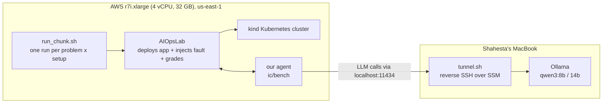
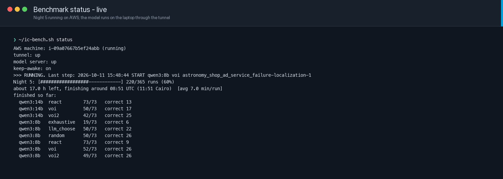
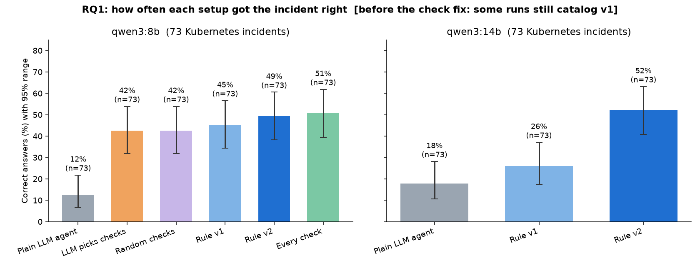
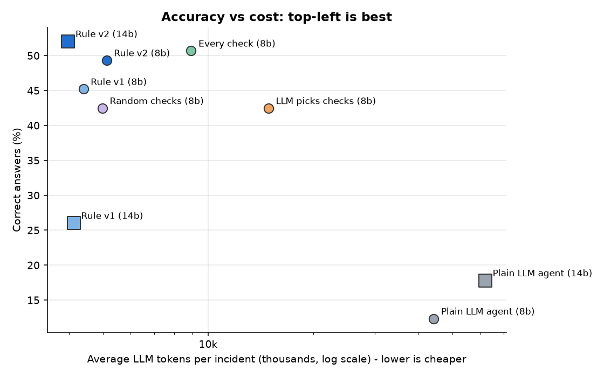
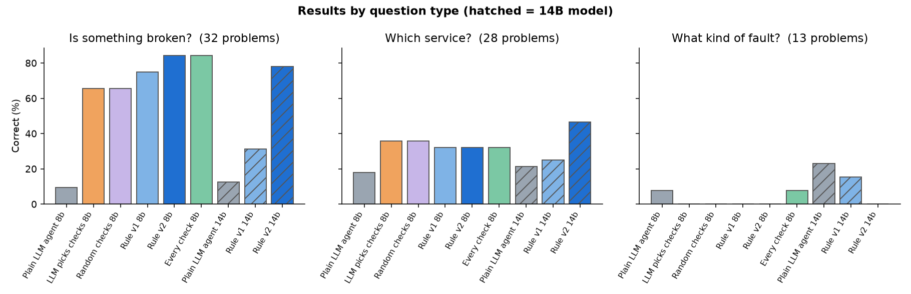

# 4. RQ1: the benchmark

> **Provisional numbers.** Everything below includes 201 runs that read two broken checks (chapter 5). Nights 5–6 re-run them; the charts here are regenerated afterwards, so they always match the data.

## What AIOpsLab is

[AIOpsLab](https://github.com/microsoft/AIOpsLab) (Microsoft Research) deploys real microservice apps on Kubernetes, injects a real fault, asks the agent a question, and grades the answer automatically. We use its **73 Kubernetes problems** (two Docker-based problems were excluded because they hang; this is a stated limitation). Three apps:

| App | Namespace | Problems |
|---|---|---|
| Hotel Reservation (DeathStarBench) | test-hotel-reservation | 31 |
| Astronomy Shop (OpenTelemetry demo) | astronomy-shop | 23 |
| Social Network (DeathStarBench) | test-social-network | 19 |

Three kinds of question: **detection** (32 problems: "is something wrong?"), **localization** (28: "which service?"), **analysis** (13: "what kind of fault, at what layer?").

## The six setups

All use the same model, the same tools and the same problems.

| Label | Who chooses the next check | Who decides to stop | What it tests |
|---|---|---|---|
| **Plain LLM agent** (ReAct) | LLM, free shell access | LLM | today's standard agent |
| **LLM picks checks** | LLM, from our check list | LLM | same hypotheses as ours; only the *decider* differs |
| **Random checks** | random among useful checks | our stop rule | is the *ordering* worth anything? |
| **Rule v1** | our rule | our rule | ours (original) |
| **Rule v2** | our rule | our rule | ours (after the fix) |
| **Every check** | runs all checks | budget | accuracy ceiling for the hypotheses |

## How it runs: AWS + your laptop

- The model runs **on the laptop** (free; AWS refused our GPU quota). The AWS machine reaches it through a reverse SSH tunnel carried over AWS Systems Manager, so no ports are open to the internet.
- `~/ic-bench.sh night N` starts everything: machine, code sync, tunnel, keep-awake. Results append to `~/results/full_rq1.jsonl` on the machine; `fetch` copies them to `results/aiopslab_full_rq1/`.
- Runs are **resumable**: a finished run is skipped, and an interrupted one is re-run from scratch on a cleaned cluster.

## Results (provisional)

| Model | Setup | Correct (95% range) | LLM tokens per incident (in + out) | LLM calls | Checks |
|---|---|---|---|---|---|
| 8B | Plain LLM agent | 12% (7–22%) | 44k | 16.7 | 16.1 |
| 8B | LLM picks checks | 42% (32–54%) | 15k | 4.8 | 2.2 |
| 8B | Random checks | 42% (32–54%) | 5.0k | 1.6 | 3.2 |
| 8B | Rule v1 | 45% (34–57%) | 4.4k | 1.4 | 2.2 |
| 8B | Rule v2 | 49% (38–61%) | 5.1k | 1.8 | 3.0 |
| 8B | Every check | 51% (39–62%) | 8.9k | 5.0 | 25.0 |
| 14B | Plain LLM agent | 18% (11–28%) | 62k | 21.9 | 21.5 |
| 14B | Rule v1 | 26% (17–37%) | 4.1k | 1.2 | 4.9 |
| 14B | Rule v2 | 52% (41–63%) | 4.0k | 1.2 | 5.2 |

**Paired comparisons** (same problems; "only A / only B" = problems one setup solved and the other didn't):

| Comparison | Only first | Only second | p | Meaning |
|---|---|---|---|---|
| 8B rule v2 vs plain LLM | 29 | 2 | <0.000001 | clear win |
| 14B rule v2 vs plain LLM | 28 | 3 | 0.000005 | clear win |
| 14B rule v2 vs rule v1 | 22 | 3 | 0.0002 | the fix mattered for 14B |
| 8B rule v2 vs rule v1 | 3 | 0 | 0.25 | no real difference on 8B |
| 8B rule v2 vs LLM picks checks | 10 | 5 | 0.3 | a tie in accuracy, at about a third of the tokens |
| 8B rule v2 vs every check | 3 | 4 | 1.0 | a tie, at about 60% of the tokens and 1/8 of the checks |
| 14B rule v2 vs 8B rule v2 | 7 | 5 | 0.77 | the bigger-model collapse is gone |

## What it means (so far)

1. **The rule beats the plain LLM agent by a lot**, on both models, at about 1/9 to 1/15 of the tokens.
2. **Against "LLM picks checks" it's a tie in accuracy at about a third of the cost.** The honest claim is *same accuracy, much cheaper, and predictable*, not "more accurate".
3. **Analysis questions (fault type) are near 0% for every setup.** Our checks can't tell fault *types* apart; that's a limitation, not a rule problem.
4. **False alarms on "nothing is broken" problems** are only partly fixed (8B 1/3, 14B 2/3 correct).

## Still to come

- **Night 5 (8B)** and **Night 6 (14B)**: the 201 re-runs on the fixed checks, plus the **14B "LLM picks checks"** setup, so the 14B table is complete.
- Then re-make the charts, re-run the paired tests and update this chapter.
