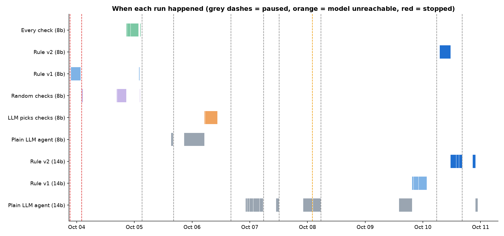
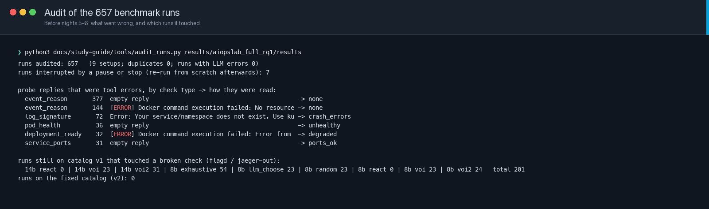
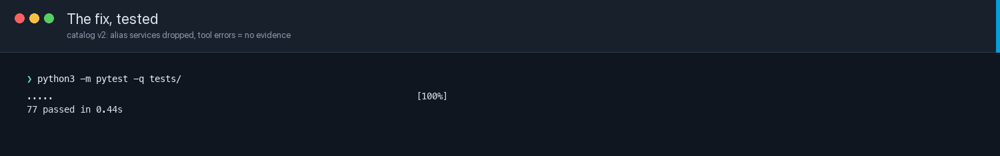

# 5. Run diary: every problem and fix

The question for each problem: **did it only cost time, or could it have changed the results?**

*Each bar is a run. Grey dashes are pauses, the orange dash is "model unreachable", red dashes are stops or restarts.*

## Timeline

| Date (2026) | What happened |
|---|---|
| 2 Oct | Pilot on free cloud models: Gemini's free tier allowed only 20 requests a day. **Switched to local models** (qwen3:8b on the laptop, via a tunnel). Pilot, 10 problems × 5 setups: plain LLM 10%, rule 50%. |
| 3 Oct | Calibration fixes before the real runs (priors, per-check error rates, log tail only). Downloaded 14B. |
| 3–5 Oct | **Night 1** (8B: rule v1, random, every check). Docker-based problems excluded (they hang). One bug found and fixed (below); 9 runs redone. |
| 5–6 Oct | **Night 2** (8B: plain LLM, LLM picks checks). |
| 6–10 Oct | **Night 3** (14B: plain LLM, rule v1). Many pauses: laptop heat, lid closed, Low Power Mode. 14B rule v1 **collapsed to 26%**. |
| 10 Oct | Diagnosed the collapse and wrote **rule v2**; the replay tool predicted the fix. |
| 10–11 Oct | **Night 4** (rule v2 on 8B and 14B, plus 3 plain-LLM retries). |
| 11 Oct | **Audit of all 657 runs** found the broken-checks bug. Fix (catalog v2) committed; **Nights 5–6 re-run the 201 affected runs.** |

## Every problem, and whether it touched the results

| # | Problem | Cost time? | Changed results? | What we did |
|---|---|---|---|---|
| 1 | Free cloud models rate-limited | yes | no (pilot only) | Local models via Ollama + tunnel |
| 2 | Wi-Fi drops, laptop sleep, lid closed, tunnel down | **yes**, many hours | **no**: an interrupted run is thrown away and re-run from scratch on a cleaned cluster | Runner waits up to 30 min for the model; `pause` cleans up; keep-awake |
| 3 | Stale tunnel port on the AWS machine after a drop | yes | no | `ClientAliveInterval 30` on the host's SSH server |
| 4 | Runbook's "is the model downloaded" check failed (`pipefail` + `grep -q`) | yes | no | Fixed in `~/ic-bench.sh` |
| 5 | Laptop heat, Low Power Mode | yes | **wall-clock times only**: they aren't comparable across nights | We report tokens, LLM calls and checks, **never seconds** |
| 6 | 3 plain-LLM 14B runs hit the 45-min limit (Low Power Mode) | yes | would have counted as failures | Retried in Night 4 with a 90-min limit |
| 7 | 2 Docker problems (flower) hang | yes | yes: scope is 73, not 75 | Excluded; stated as a limitation |
| 8 | **Bug:** on `assign_to_non_existent_node`, every LLM hypothesis named a pod or node, not a service, so all were filtered out and only "no fault" was left | no | **yes**: 100% wrong on those problems | Retry with exact service names + a safety-net hypothesis for any visibly unhealthy pod; 9 runs redone (5 Oct) |
| 9 | **14B rule v1 collapse (26%)**: 14B writes more, very specific hypotheses, and catches crash-looping pods while briefly "Running", so the specific predictions were contradicted and "no fault" won | no | **yes** | Rule v2 (chapter 3). Report both versions; v2 needs held-out confirmation |
| 10 | **Bug: broken checks** (found by the 11 Oct audit, below) | no | **yes**, a few points, for every check-based setup | Catalog v2 fix + Nights 5–6 re-runs |
| 11 | One random-checks run (4 Oct 02:08) started right after a restart without cleaning the cluster | no | maybe 1 run | Noted; too small to matter, but it gets re-checked in the final audit |

## The audit (11 Oct) and the broken-checks bug

We went through every saved run looking for tool errors: replies where the *tool* failed, not the service.

What it found:

- Most tool errors were harmless. An empty `grep` means "no matching lines" and was correctly read as "no warning events" or "ports OK".
- **Two were not:**
  - **`jaeger-out`** (Hotel Reservation) is an *alias* Service: it points at another workload's pods and has none of its own. Every check on it said "no pods" or "no deployment", which our check reader took as **broken**.
  - **`flagd`** (Astronomy Shop): its pod runs fine, but AIOpsLab's log tool can't find it and answers "service does not exist", which our check reader took as a **crash**.
- **201 runs** read one of these. The plain LLM agent was never affected (it doesn't use our check list).
- **Effect, estimated offline:** the false "broken" readings actually *helped* some detection answers (8B rule v1 drops from about 33 to about 27 correct without them) and hurt localization (8–11 answers per setup blamed `flagd` or `jaeger-out`). Every check-based setup was hit about equally, so the *comparisons* mostly hold, but the *absolute* numbers move. Only a live re-run settles it.

**The fix (catalog v2, commit `ec49d90`):**
1. During discovery, also list Deployments and StatefulSets, and keep only services that are real workloads (a service scaled to zero is kept, since that can be the fault).
2. If a check's tool fails ("does not exist", "NotFound"), the step is spent but **no belief changes**.
3. Every result records `catalog_version` and `dropped_services`, so old and new runs can't be mixed by accident.

**How the re-run is kept fair:**
- The 201 affected runs were moved to an archive file on the AWS machine (`full_rq1_catalog_v1_archive.jsonl`; nothing deleted), and Nights 5–6 re-run exactly those.
- Runs that never touched the broken checks are unchanged, because the fix doesn't alter anything they saw.
- The first re-run was checked by hand: discovery worked, `opensearch-headless` (another alias) was dropped, and the result carries `catalog_version: 2`.

## Lessons for next time (apply to RQ3)

1. **Audit tool errors before believing a result.** A tool failure isn't evidence.
2. **Never tune on the test set without saying so.** v2 and any future v3 must be confirmed on unseen problems.
3. **Record cost in tokens and checks, not seconds**, unless every run happens on the same hardware.
4. **Every result should carry the code version** that produced it (we now store `rule_version` and `catalog_version`).
5. **Run long jobs where the laptop isn't the weak link**; the laptop caused most of the lost time.
