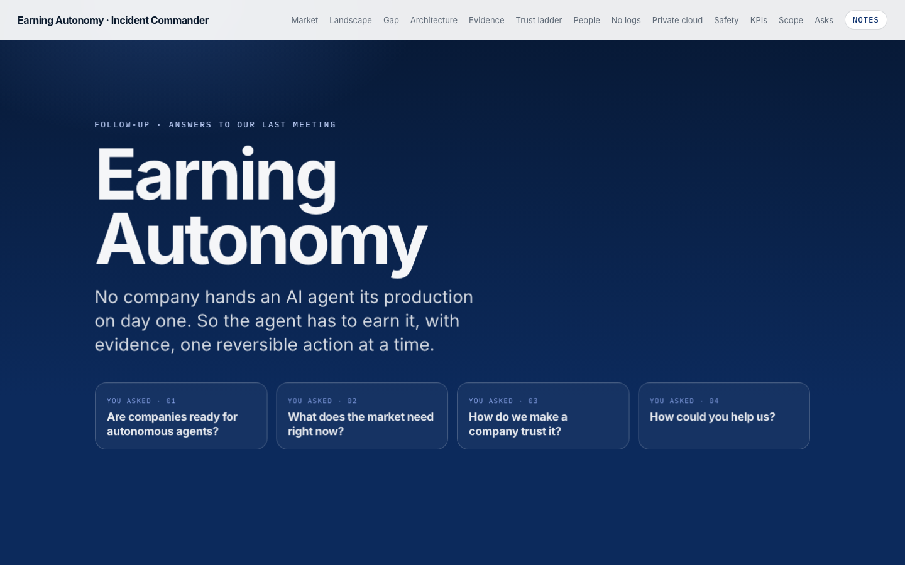
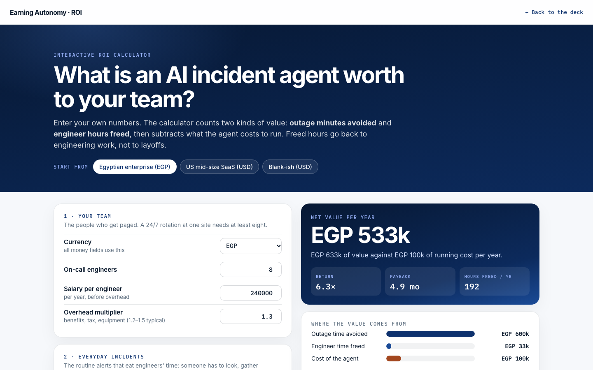
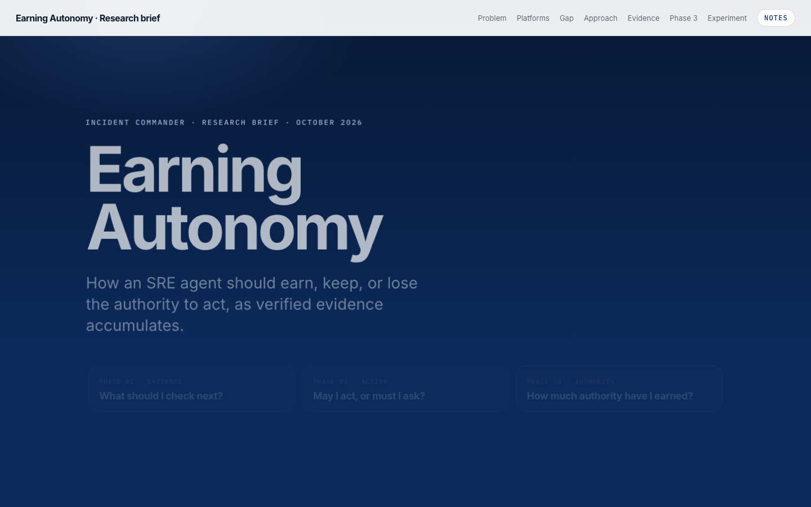
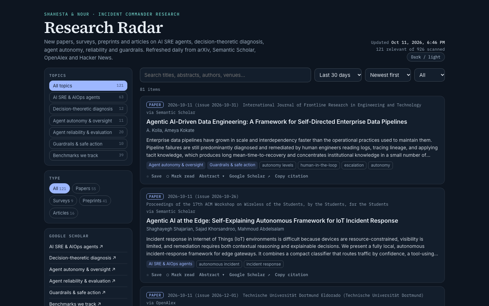
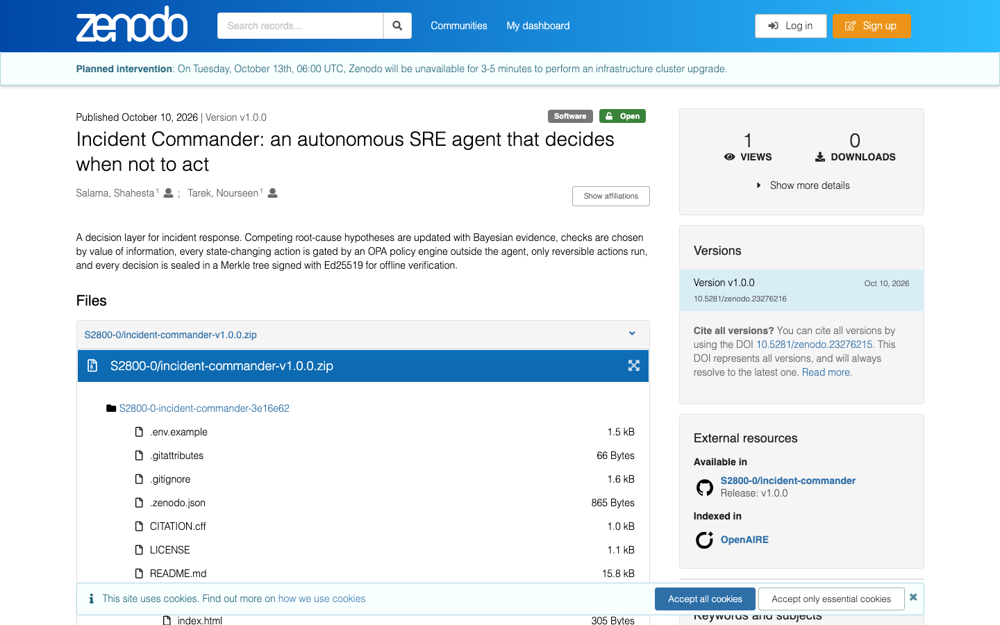
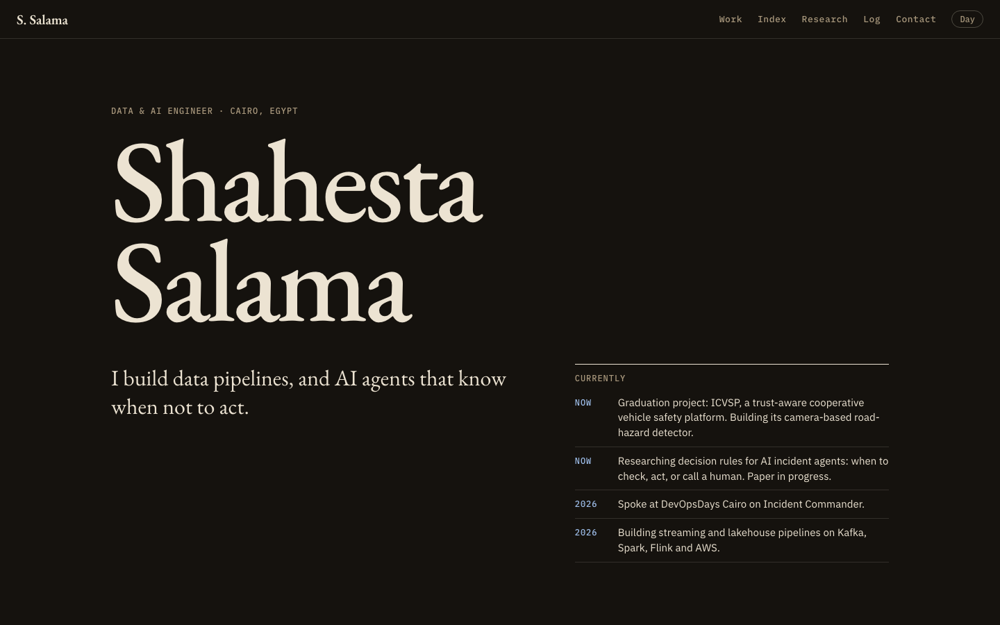

# 8. What we published

Everything here is **public**. Rule of thumb: Phase 1 and general results can be public; the Autonomy Drift idea must not be (not until we decide about a patent).

## Earning Autonomy deck

**[earning-autonomy.vercel.app](https://earning-autonomy.vercel.app)**: made after the Deloitte expert meeting. It answers his four questions: are companies ready, what the market needs, how to earn trust, and how he could help. Press **N** for presenter notes. Source: `deck-trust/` (not in git); redeploy with `npx vercel deploy --prod --yes`.

The interactive ROI page: [earning-autonomy.vercel.app/roi.html](https://earning-autonomy.vercel.app/roi.html)

## Research brief

**[earning-autonomy-brief.vercel.app](https://earning-autonomy-brief.vercel.app)**: the 8-part research brief (Phase 1 evidence → Phase 2 act → Phase 3 adaptive authority). Source: `deck-brief/`.

## Research Radar (for us two)

**[research-radar-phi.vercel.app](https://research-radar-phi.vercel.app)**: new papers every day from arXiv, Semantic Scholar, OpenAlex and Hacker News, over 6 topics. It has save, mark-read, copy-citation and Google Scholar links; your saves stay in your own browser. Add `?fresh=1` to skip the one-day cache. Source: `research-feed/`.

## Zenodo (citable DOI)

Release v1.0.0 of the public repo: **DOI [10.5281/zenodo.23276216](https://doi.org/10.5281/zenodo.23276216)**. Authors: Salama, Shahesta; Tarek, Nourseen. Cite all versions with 10.5281/zenodo.23276215.

## GitHub

- Public: [S2800-0/incident-commander](https://github.com/S2800-0/incident-commander). Phase 1 demo, README, CITATION.cff, MIT license. `main` stays the frozen demo; changes go in through PRs only. PR #3 ("graduation research" → "ongoing research") is waiting to be merged.
- Private: **S2800-0/incident-commander-research** (this repo): the benchmark, simulator, results tools and this guide.

## Portfolio

[s2800-0.github.io/portfolio](https://s2800-0.github.io/portfolio/)

**Wording rule everywhere:** Incident Commander is *independent research* by Shahesta and Nour, **not** the graduation project (that's ICVSP, AI add-ons for existing cars).
