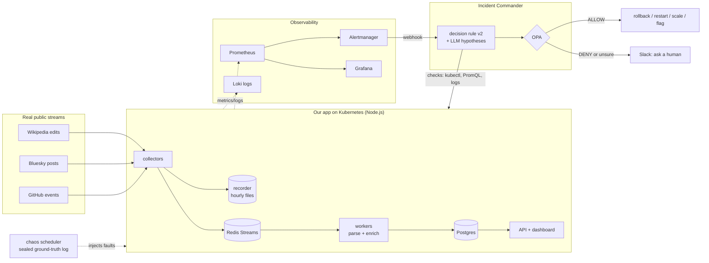

# 9. RQ3: the live system (plan)

**Status: planned, not built.** This is the build plan for the next phase, from our mentor's suggestion: "run it live, with Prometheus, on a real Node.js app".

## Why live, if the benchmark already ran real apps?

The benchmark is an **exam**: one fault, one question, then reset. Real operations aren't:

| | Benchmark (RQ1) | Live system (RQ3) |
|---|---|---|
| App | Microsoft's demo apps | **Our own** Node.js app |
| Traffic | none or scripted | **real public data streams**, never-ending |
| Faults | one at a time, announced | random, unannounced, plus **natural** ones |
| Agent's job | answer a question | notice the alert, investigate, **fix or escalate** |
| Human | none | **a real human in Slack** approves or rejects |
| Time | one episode | days of operation; the system **changes over time** |
| Metrics | % correct | time to fix, wrong fixes, false alarms, escalations, cost |

It also answers our two open weaknesses:
1. **Held-out test for rule v2**: these are faults the rule has never seen.
2. **Real act-or-escalate**: RQ2 was only a simulator.

## Real traffic: public live streams

No fake users. The app consumes real streams, so the load is real: bursty, with daily cycles and spikes when things happen in the world.

| Source | What it is | Notes |
|---|---|---|
| **Wikimedia EventStreams** (`stream.wikimedia.org/v2/stream/recentchange`) | Every Wikipedia edit worldwide, live, server-sent events | Free, no key; must send a descriptive `User-Agent`. Steady load with day/night cycles |
| **Bluesky Jetstream** (`jetstream*.bsky.network/subscribe`) | Live public posts and likes, WebSocket | Free; heavy and spiky; filter by collection |
| **GitHub Events API** (`api.github.com/events`) | Public GitHub activity | Polling, 5,000 requests/h with a token; respects `X-Poll-Interval`. Produces **real rate-limit failures** |
| **GH Archive** (`data.gharchive.org`) | Every public GitHub event since 2011, in hourly files | **Replay**: the exact same traffic for every agent |
| **Slack** | Our own workspace | **Not traffic.** It's where the agent asks a human: approve / reject buttons (Socket Mode, so no public URL is needed) |

## Architecture

**Two modes:**
- **Live mode**: real streams, for realism, the demo and natural incidents.
- **Replay mode**: the recorder's files (or GH Archive) played back at the original timing, so **every agent sees identical traffic** and comparisons are fair.

## Faults (injected at random, unannounced)

| Fault | How | Right response |
|---|---|---|
| Bad deploy (new version throws errors) | deploy a broken image tag | rollback (reversible) |
| Memory leak | feature flag in the worker | restart, then escalate if it recurs |
| Slow database | `tc netem` delay, or a lock-holding query | don't roll back; escalate or scale |
| Redis full | lower `maxmemory` | scale / config; escalate |
| Upstream cut | block egress to one stream | **don't act** (not our bug); wait or escalate |
| Bad config (wrong port or env) | config change | rollback the config |
| Crash loop | invalid flag | rollback |
| Disk filling | log spam | escalate |
| **Natural** | stream disconnects, GitHub rate limits, malformed events, bursts | labelled afterwards by us (two-person review) |

Ground truth is written to a **sealed log** that the agent can't read; the scorer compares against it afterwards.

## What we compare

Same faults, same replayed traffic:
1. **Rule v2** (ours, frozen: no tuning on these faults).
2. **Plain LLM agent** with the same tools and actions.
3. **LLM decides, rule advises** (the "LLM picks checks" equivalent).
4. **Always escalate** (the human-only baseline: safe but slow).

## What we measure

| Metric | Why |
|---|---|
| Detection delay, time to mitigation | speed |
| Correct diagnosis (service, cause) | accuracy |
| **Harmful actions** (acted wrongly) | safety: the most important |
| Escalations: needed vs unneeded | how much it bothers humans |
| Human minutes spent | real cost of a human |
| LLM tokens and calls | running cost |
| False alarms per day | trust |

## Build plan (about 4 weeks)

| Week | Build | Who (suggested) |
|---|---|---|
| 1 | Node.js collectors + Redis Streams + workers + Postgres; Prometheus metrics (`prom-client`), Grafana dashboard | Shahesta (data pipeline experience: Redis, Cassandra, NiFi) |
| 2 | Recorder + replay mode; chaos scheduler + sealed ground-truth log | Nour |
| 3 | Agent wiring: Alertmanager webhook → rule; new checks (PromQL, logs); actions behind OPA; Slack approve/reject | both |
| 4 | Pilot: 2–3 live sessions of 4–6 h; fix what breaks; freeze everything | both |
| then | Experiment: replay sessions × 4 setups; live sessions for the realism results | — |

**Where it runs:** the same AWS machine (enough for kind + app + Prometheus), in 4–6 h sessions (about $0.27/h); the model stays on the laptop via the tunnel. Code goes in this private repo under `testbed/`.

**What "done" looks like:** a Grafana screenshot of a real incident, the agent's decision trail, the Slack message and the sealed evidence, all from one unplanned fault.

## Rules we keep this time (from chapter 5)

- Freeze the rule before the experiment; every result records `rule_version`, `catalog_version` and the app version.
- Audit tool errors before reading results.
- Report tokens and checks, not seconds, unless the hardware is identical.
- Keep the private parts private (see the README note).
