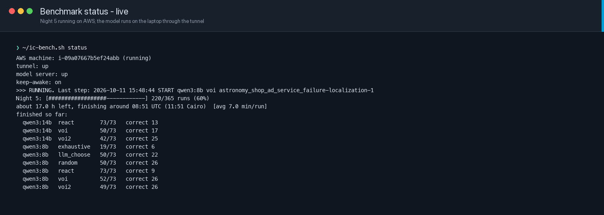

# 10. How to run things

All benchmark commands go through `~/ic-bench.sh` on Shahesta's laptop. A copy without personal details lives in `infra/bench.sh` in this repo (port changes by hand; **never** copy the laptop version over it, because it holds the email and paths).

## Commands

| Command | What it does |
|---|---|
| `~/ic-bench.sh night N` | Starts night N: AWS machine on, code synced, model + tunnel + keep-awake on the laptop, runs in the background |
| `~/ic-bench.sh status` | Progress bar, ETA, finished runs per setup |
| `~/ic-bench.sh watch` | `status` refreshed every 5 min (Ctrl-C stops watching, not the run) |
| `~/ic-bench.sh fetch` | Copies all results to `results/aiopslab_full_rq1/` |
| `~/ic-bench.sh table` | Results table from the fetched data |
| `~/ic-bench.sh pause` | Stops the run cleanly and stops the AWS machine (disk kept, about $0.40/day) |
| `~/ic-bench.sh redo <text>` | Forgets runs whose problem name contains `<text>`, so the next night re-runs them |
| `~/ic-bench.sh down` | Fetch, pause, then delete the whole AWS stack ($0/day) |

| Night | Model | Setups |
|---|---|---|
| 1 | 8B | rule v1, random, every check |
| 2 | 8B | plain LLM, LLM picks checks |
| 3 | 14B | plain LLM, rule v1 |
| 4 | 8B then 14B | rule v2 (+ 3 plain-LLM retries) |
| **5** | 8B | re-runs on the fixed checks (rule v1, v2, random, every check, LLM picks) |
| **6** | 14B | re-runs on the fixed checks (rule v1, v2) + **14B LLM picks checks** (all 73) |

## During a night

- Laptop **plugged in, online, lid open**. Low Power Mode is fine for 8B but slows 14B.
- You get a Mac notification when the night finishes or stops early.
- If it stops, run the same `night N` again: it continues where it left off.



## After a night

```bash
~/ic-bench.sh fetch
~/ic-bench.sh table
python3 research/docs/study-guide/tools/audit_runs.py results/aiopslab_full_rq1/results
python3 research/docs/study-guide/tools/make_charts.py results/aiopslab_full_rq1/results
~/ic-bench.sh pause
```

Then check the credits (AWS Billing → Credits). So far the whole benchmark has used about $27, all covered by credits.

## Code map

| Path | What |
|---|---|
| `ic/bench/decide.py` | The decision rule (beliefs, EIG, VoI, stop) |
| `ic/bench/agent.py` | Our agent: discovery, hypotheses, checks, answers |
| `ic/bench/probes.py` | The check catalog and how each reading is labelled |
| `ic/bench/hypotheses.py` | LLM hypothesis generation |
| `ic/bench/baselines.py` | Plain LLM agent, LLM picks checks, random, every check |
| `ic/bench/run_aiopslab.py` | Runs one problem in AIOpsLab |
| `ic/bench/analyze.py` | The results table |
| `ic/bench/replay.py` | Offline re-decision of saved runs |
| `ic/rq2/` | The act-or-escalate simulator |
| `tests/` | `python3 -m pytest -q tests/` (77 tests) |
| `infra/bench-host.yaml` | CloudFormation for the AWS machine |
| `infra/tunnel.sh` | Reverse SSH tunnel to the laptop's model |
